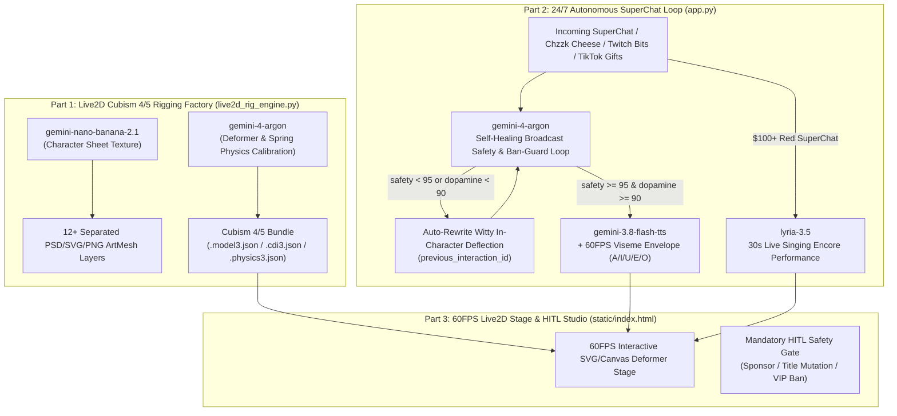

# 03 — CTO System Architecture & Google GenAI SDK Patterns (`AETHER-VTUBE 24/7`)

## 1. End-to-End Architecture Diagram

---

## 2. Official `google-genai >= 2.30.1` Interactions API Compliance
Every model invocation strictly follows the Oct 2026 `google-genai >= 2.30.1` Interactions API (`client.interactions.create(...)`):
- **No legacy `generate_content`**: All text, structured JSON (`response_format`), image (`gemini-nano-banana-2.1`), audio (`gemini-3.8-flash-tts`), and music (`lyria-3.5`) calls use `client.interactions.create(...)` with plain dict `generation_config` and `thinking_level`.
- **Stateful Self-Healing Continuation**: When an adversarial donation fails Attempt #1 in the Broadcast Safety Loop, Attempt #2 chains state via `previous_interaction_id` to produce an in-character roast deflection that satisfies `safety_score >= 95` and `entertainment_dopamine_score >= 90`.
